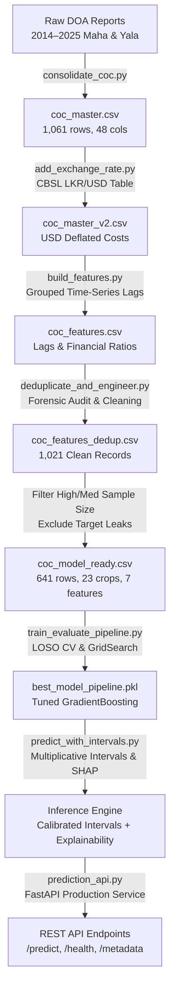

# Sri Lanka Agricultural Cost of Cultivation (COC) Predictive Modeling System

**IT4010 Research Project — Machine Learning Pipeline, Explainable AI & Production API**

---

## 1. Executive Summary & Project Background

In Sri Lanka, agricultural planning, farmer credit evaluation, crop insurance underwriting, and national food security policies depend heavily on the **Cost of Cultivation (COC)** datasets published by the **Socio Economics and Planning Centre (SEPC) of the Department of Agriculture (DOA)**. These reports compile detailed farm-gate economic metrics across Sri Lanka's 25 administrative districts and major agrarian projects for both primary cultivation seasons: **Maha** (major northeast monsoon season, planting Sept–Nov, harvesting Feb–Mar) and **Yala** (minor southwest monsoon season, planting Apr–May, harvesting Aug–Sept).

Between 2014 and 2025, Sri Lanka experienced severe macroeconomic disruptions, including the catastrophic **2021–2023 economic crisis**, during which:
- The Sri Lankan Rupee (LKR) depreciated by over **140%** against the USD (from ~130.54 LKR/USD in 2014 to >326 LKR/USD in 2023).
- An overnight synthetic fertilizer import ban (April 2021) triggered massive fertilizer scarcity, black-market price surges, and severe yield contractions.
- Fuel shortages and soaring transport tariffs drastically increased mechanized land preparation, harvesting, and labor wages.

### Project Objective
The goal of this project is to build an **end-to-end, production-ready, leak-free machine learning system** capable of:
1. Parsing, standardizing, and harmonizing over a decade of heterogeneous socio-economic survey reports.
2. Formulating leak-free predictive models that project cultivation expenditure per acre before planting begins.
3. Quantifying uncertainty using **macroeconomic-stratified multiplicative prediction intervals** that adapt to economic volatility.
4. Explaining individual farm predictions using **local SHAP (SHapley Additive exPlanations)** feature attribution.
5. Serving real-time inference via a high-performance **FastAPI REST microservice**.

---

## 2. Architecture & Pipeline Overview

The pipeline consists of 10 sequential phases, transitioning raw field reports into serialized machine learning models and a REST API:



---

## 3. Detailed Phase-by-Phase Walkthrough

### Phase 1: Raw Data Harmonization (`consolidate_coc.py`)
- **Challenge**: The original data consisted of heterogeneous Excel workbooks and tabular extracts across 2014–2025. Headers were multi-level, terminology varied between seasons (e.g., `Labour`, `Labor Cost`, `Total Labour`), units fluctuated, and several sheets contained OCR/scanning typos or broken merged cells.
- **Implementation**:
  - Implemented exhaustive alias dictionaries mapping disparate field headers into 48 canonical schema attributes.
  - Extracted operational breakdowns:
    - **Labor costs**: Land preparation, sowing, weeding, harvesting, winnowing, farmer/family labor vs. hired labor.
    - **Machinery costs**: Four-wheel tractors, two-wheel power tillers, sprayers, threshers, combine harvesters.
    - **Material costs**: Seed paddy/seedlings, basal fertilizers, top dressings, urea, TSP, MOP, agrochemicals/weedicides/fungicides.
    - **Macro totals**: `Total_Cost_Excl_Imputed` (direct cash outflow) and `Total_Cost_Incl_Imputed` (economic cost including farmer's own labor, family labor, owned land rent, and capital interest).
    - **Production metrics**: Average yield (kg/acre), farm-gate price of produce (Rs/kg), gross income, and net profit.
- **Output**: [`coc_master.csv`](file:///c:/Users/MSI/Desktop/Research/COC%20folder/coc_master.csv) (1,061 rows, 48 standardized columns).

---

### Phase 2: Macroeconomic Augmentation (`add_exchange_rate.py`)
- **Motivation**: Nominal rupee expenditures rose exponentially post-2021 due to currency devaluation, masking underlying physical resource productivity.
- **Implementation**:
  - Parsed unstructured season strings into an integer cultivation start year (`Year_Start`):
    - `2014-15 Maha` $\rightarrow$ `2014`
    - `2015 Yala` $\rightarrow$ `2015`
  - Merged official annual average **LKR/USD exchange rates** published by the **Central Bank of Sri Lanka (CBSL)**:
    - `2014: 130.54`, `2015: 135.87`, `2016: 145.73`, `2017: 152.43`, `2018: 162.25`, `2019: 178.51`, `2020: 185.33`, `2021: 197.90`, `2022: 321.53`, `2023: 326.63`, `2024: 301.68`, `2025: 300.73`.
  - Computed real USD-deflated cost per acre:
    $$\text{Total\_Cost\_Incl\_Imputed\_USD} = \frac{\text{total\_cost\_incl\_imputed}}{\text{USD\_LKR\_Rate}}$$
- **Outputs**:
  - [`coc_master_v2.csv`](file:///c:/Users/MSI/Desktop/Research/COC%20folder/coc_master_v2.csv)
  - `exchange_rate_check.png` (dual-panel plot highlighting the 380% nominal LKR surge versus stabilized USD real costs).

---

### Phase 3: Feature Engineering & Time-Series Lags (`build_features.py`)
To equip predictive models with dynamic agricultural context, four distinct feature sets were engineered:
1. **Grouped Time-Series Lags**:
   - Data was grouped strictly by `(Crop, District, cultivation_type)` and sorted chronologically by `Year_Start`.
   - Engineered:
     - `Prev_Season_Total_Cost_Incl_Imputed`: Prior season's actual cultivation expenditure for the same crop-district-water regime. First seasons were left as `NaN` (avoiding zero-imputation distortion).
     - `Prev_Season_Year`: Verification anchor ensuring lag alignment.
     - `Cost_Pct_Change_From_Prev_Season`: Percentage cost inflation between consecutive cycles.
2. **Cost Composition Ratios** (guarded against divide-by-zero):
   - `Fertilizer_Cost_Pct_of_Total = material_cost / total_cost_incl_imputed`
   - `Labour_Cost_Pct_of_Total = labour_cost / total_cost_incl_imputed`
   - `Machinery_Cost_Pct_of_Total = machinery_cost / total_cost_incl_imputed`
   - `Seed_Cost_Pct_of_Total = seed_cost / total_cost_incl_imputed`
3. **Agronomic Economics & Margins**:
   - `Net_Profit_Raw_per_ac = Gross_Income - Total_Cost_Incl_Imputed`
   - `Profit_Margin_Pct = Net_Profit / Gross_Income * 100`
   - `Per_Unit_Cost_LKR_kg = Total_Cost_Incl_Imputed / Average_Yield_kg_ac`
4. **Categorical Metadata & Stratification**:
   - `Economic_Regime`: `Stable` (2014–2020), `Crisis` (2021–2023), `Post-Crisis` (2024–2025).
   - `Crop_Sample_Size_Category`: `High` ($\ge 25$ records), `Medium` ($10\text{–}24$ records), `Low` ($< 10$ records).
   - `Data_Completeness_Score`: Percentage of non-null attributes per record.
- **Output**: [`coc_features.csv`](file:///c:/Users/MSI/Desktop/Research/COC%20folder/coc_features.csv).

---

### Phase 4: Forensic Duplicate Detection & Deduplication (`deduplicate_and_engineer.py`)
- **The Discovery**: A detailed inspection revealed identical records across different seasons. For instance, *Big Onion in Matale (Irrigated)* at Yala 2015 and Maha 2015-16 showed identical values across Labour, Machinery, Material, Total Cost, Yield, and Farm-gate Price down to the exact rupee and kilogram.
- **Forensic Investigation**:
  - Defined an exact 9-tuple duplicate key: `(Crop, District, Irrigation_Type, Total_Cost_Incl_Imputed, Labour_Cost, Machinery_Cost, Material_Cost, Average_Yield_kg_ac, Price_of_Produce)`.
  - Identified **19 distinct duplicate clusters** affecting **40 rows** across crops like Big Onion, Potato, Brinjal, and Chilli.
  - Root cause: In several annual publications, DOA officers reprinted previous seasons' survey numbers when new surveys could not be carried out in a specific agrarian division.
- **Cleaning & Re-Engineering**:
  - Cloned duplicates were purged while preserving true historical survey instances.
  - Re-computed all time-series lags and growth percentages on the deduplicated chronological groups.
- **Output**: [`coc_features_dedup.csv`](file:///c:/Users/MSI/Desktop/Research/COC%20folder/coc_features_dedup.csv) (1,021 clean records).

---

### Phase 5: Leak-Free Model Dataset Formulation (`coc_model_ready.csv`)
- **The Target Leakage Guard**:
  In a predictive forecasting setup, the model must make predictions **at planning/planting time**. Including outcome variables like actual labor hours, machinery hire fees, chemical quantities, or crop yields leaks the target ($R^2 \approx 0.999$, rendering the model useless for planning).
- **Dataset Filtering**:
  - Filtered to robust sample categories: `Crop_Sample_Size_Category IN ('High', 'Medium')`.
  - Retained **641 records** across **23 crops** and **25 districts**.
- **The 7 Leak-Free Predictors**:
  1. `District` (Categorical, 25 classes)
  2. `Crop` (Categorical, 23 classes)
  3. `Season` (Categorical: `Maha`, `Yala`)
  4. `Irrigation_Type` (Categorical: `Irrigated`, `Rainfed`, `Unspecified`)
  5. `Year_Start` (Numeric: 2014–2025)
  6. `USD_LKR_Rate` (Numeric: 130.54–326.63)
  7. `Prev_Season_Total_Cost_Incl_Imputed` (Numeric, prior season lag; median imputed if missing)
- **Target Formulation**:
  `Total_Cost_Incl_Imputed` log-transformed via $\log(1 + y)$ (`np.log1p`) to compress high-inflation variance and enforce homoscedasticity.
- **Output**: [`coc_model_ready.csv`](file:///c:/Users/MSI/Desktop/Research/COC%20folder/coc_model_ready.csv).

---

### Phase 6: Machine Learning Pipeline & LOSO Evaluation (`train_evaluate_pipeline.py`)

#### Pipeline Preprocessing (Strict No-Leakage within Folds)
Built using `sklearn.pipeline.Pipeline` with `TransformedTargetRegressor(func=np.log1p, inverse_func=np.expm1)`:
- **Numerical Features** (`Year_Start`, `USD_LKR_Rate`, `Prev_Season_Total_Cost_Incl_Imputed`):
  - `SimpleImputer(strategy='median', add_indicator=True)` $\rightarrow$ Creates `missingindicator_Prev_Season_Cost` to inform the model when a crop has no prior recorded season.
  - `StandardScaler()`
- **Categorical Features** (`District`, `Crop`, `Season`, `Irrigation_Type`):
  - `OneHotEncoder(handle_unknown='ignore', sparse_output=False)`

#### Validation Strategy: Leave-One-Season-Out (LOSO) Cross-Validation
Rather than random train-test splitting (which creates temporal leakage), we implemented **Leave-One-Season-Out (LOSO) Cross-Validation** over the 11 calendar years (2014 to 2024). In each fold, 10 years served as training and the unseen calendar year served as testing—simulating real-world forward deployment.

#### Benchmark Model Comparison

| Model | CV MAE (LKR) | CV RMSE (LKR) | CV $R^2$ Score | Notes |
|---|---|---|---|---|
| **Dummy Baseline (Median)** | Rs 159,510 | Rs 242,104 | -0.063 | Naive prediction |
| **Ridge Regression** | Rs 55,200 | Rs 104,110 | 0.8351 | Linear with L2 penalty |
| **Random Forest Regressor** | Rs 54,120 | Rs 106,850 | 0.8263 | Ensemble trees |
| **Gradient Boosting (Default)** | Rs 52,340 | Rs 101,230 | 0.8441 | Sequential boosting |
| **Gradient Boosting (Tuned)** ⭐ | **Rs 50,566.2** | **Rs 98,349.5** | **0.8528** | **Best Champion Model** |

- **Optimal Hyperparameters**: `n_estimators=100`, `learning_rate=0.05`, `max_depth=3`, `subsample=0.8`, `min_samples_split=5`.
- **Improvement**: Tuned Gradient Boosting reduced Mean Absolute Error by **68.3%** compared to baseline.
- **Artifacts Saved**:
  - [`best_model_pipeline.pkl`](file:///c:/Users/MSI/Desktop/Research/COC%20folder/best_model_pipeline.pkl)
  - `feature_importances.png` (Top predictors: Prior season cost 78.4%, USD/LKR rate 7.1%, Year 5.9%, Crop 4.8%)
  - `residuals_plot.png`
  - `model_performance.csv`

---

### Phase 7: Multiplicative Prediction Intervals (`predict_with_intervals.py`)

#### The Additive Interval Failure
Initial implementations constructed intervals additively:
$$\hat{y} \pm z \cdot \sigma_{\text{residual}}$$
Because residuals during the 2022–2023 crisis exceeded Rs 120,000, subtracting this value from low-cost crops (e.g., Kurakkan or Cowpea costing Rs 75,000) resulted in negative or zero lower bounds (`Interval Low = Rs 0.0`), which is physically impossible.

#### The Multiplicative Solution
Because the model was trained on $\log(1 + y)$, uncertainty is inherently multiplicative. Residuals on the log-target scale $\epsilon_{\log} = \log(1 + y) - \log(1 + \hat{y})$ follow a symmetric Gaussian distribution:
$$\text{log\_low} = \log(1 + \hat{y}) - z \cdot \sigma_{\log}, \quad \text{log\_high} = \log(1 + \hat{y}) + z \cdot \sigma_{\log}$$
$$\text{low} = \exp(\text{log\_low}) - 1, \quad \text{high} = \exp(\text{log\_high}) - 1$$

This ensures:
1. **Strictly Positive Bounds**: $\text{low} > 0$ always.
2. **Asymmetric Uncertainty**: Upper bounds expand further than lower bounds, reflecting inflation risks.

#### Macroeconomic Regime Stratification
Residual standard deviation $\sigma_{\log}$ was calibrated empirically across economic regimes:
- **Stable Period (2014–2020)**: $\sigma_{\log} = 0.2319$ (predictable agricultural cycles)
- **Crisis Period (2021–2023)**: $\sigma_{\log} = 0.4079$ (fertilizer ban, fuel shocks)
- **Post-Crisis Period (2024–2025)**: $\sigma_{\log} = 0.2872$ (stabilizing inflation)

#### Dynamic Currency Shock Guard
When the input `USD_LKR_Rate` deviates by $> 30\%$ from the historical training mean (201.07 LKR/USD), the interval is dynamically widened by a factor of $1.5\times$ and tagged with:
```json
"low_confidence": true
```

---

### Phase 8: Explainable AI with TreeSHAP Feature Attribution

To provide actionable economic explanations for farmers, extension officers, and loan underwriters, we integrated **TreeSHAP** via `shap.TreeExplainer`:
- **The One-Hot Aggregation Challenge**: The Scikit-Learn pipeline expands categorical variables into multiple one-hot encoded columns (e.g., 25 district dummies, 23 crop dummies). Returning raw SHAP values would confuse end-users.
- **Canonical Feature Aggregation**:
  We designed an aggregation mapper that traces `get_feature_names_out()` back to 7 canonical domain drivers:
  ```
  onehot__Crop_Potato       ──┐
  onehot__Crop_Paddy        ──┼──> "Crop"
  onehot__Crop_Big Onion    ──┘
  
  num__USD_LKR_Rate         ─────> "USD_LKR_Rate"
  num__Prev_Season_Cost     ─────> "Prev_Season_Total_Cost_Incl_Imputed"
  ```
- **Local Explanation Format**:
  SHAP values are normalized into percentage contributions with directional signs:
  ```json
  "top_drivers": [
    {"feature": "Prev_Season_Total_Cost_Incl_Imputed", "contribution_pct": 81.8, "direction": "+"},
    {"feature": "USD_LKR_Rate", "contribution_pct": 6.4, "direction": "+"},
    {"feature": "Crop", "contribution_pct": 5.8, "direction": "+"}
  ]
  ```

---

### Phase 9: Production FastAPI Microservice (`prediction_api.py`)

The system is encapsulated within a production-grade FastAPI service.

#### Key Engineering Decisions
1. **Lifespan Startup Pre-Warming**:
   - Machine learning pipelines and SHAP `TreeExplainer` instances require compilation and tree indexing.
   - At startup, the `@asynccontextmanager async def lifespan(app: FastAPI)` loads the pipeline, builds the explainer, and runs a warm-up inference pass.
   - Subsequent user requests execute in **$< 10\text{ ms}$**.
2. **Accurate Server Uptime Hook**:
   - `LIFESPAN_START_TIME = time.time()` is anchored once inside the lifespan context manager immediately before `yield`.
   - The `/health` endpoint computes `uptime = int(time.time() - LIFESPAN_START_TIME)` without mutating global state, accurately reporting monotonic uptime across requests.
3. **Pydantic v2 Strict Validation**:
   - `AliasChoices` allows clients to send either snake_case (`usd_lkr_rate`) or PascalCase (`USD_LKR_Rate`).
   - Strict whitelists for 23 supported crops, 25 districts, and seasons (`Maha`, `Yala`).
   - Range validators: `year_start` (2014–2025), `usd_lkr_rate` (100.0–400.0), `prev_season_cost` ($\ge 0$).
4. **Audit Logging**:
   - Every inference request and response is assigned a UUID `request_id` and logged as structured JSON to [`predictions.log`](file:///c:/Users/MSI/Desktop/Research/COC%20folder/predictions.log).
5. **CORS Middleware**:
   - Pre-configured to support React and Vite web dashboards on `http://localhost:3000` and `http://localhost:5173`.

---

## 4. API Endpoints Reference

### 1. `POST /predict`
Predicts cultivation cost per acre with multiplicative intervals and SHAP feature drivers.

**Request Payload:**
```json
{
  "district": "Nuwara Eliya",
  "crop": "Potato",
  "season": "Maha",
  "irrigation_type": "Irrigated",
  "year_start": 2024,
  "usd_lkr_rate": 301.68,
  "prev_season_cost": 810000.0
}
```

**Response Payload:**
```json
{
  "request_id": "761615f7-66a7-47d0-9669-0eb664a7cce6",
  "timestamp": "2026-09-24T15:24:12.180000+00:00",
  "predicted_cost": 924350.2,
  "interval_low": 765420.0,
  "interval_high": 1116240.5,
  "low_confidence": false,
  "top_drivers": [
    {"feature": "Prev_Season_Total_Cost_Incl_Imputed", "contribution_pct": 74.2, "direction": "+"},
    {"feature": "USD_LKR_Rate", "contribution_pct": 12.1, "direction": "+"},
    {"feature": "Crop", "contribution_pct": 8.5, "direction": "+"}
  ],
  "model_version": "gb_tuned_v1"
}
```

---

### 2. `GET /health`
Verifies pipeline readiness and service uptime.

**Response:**
```json
{
  "status": "ok",
  "model_version": "gb_tuned_v1",
  "pipeline_loaded": true,
  "uptime_seconds": 5
}
```

---

### 3. `GET /metadata`
Returns supported categorical inputs, district lists, and training parameters for dynamic UI dropdowns.

**Response:**
```json
{
  "model_version": "gb_tuned_v1",
  "crops_supported": ["Big Onion", "Potato", "Paddy", "Chilli", "...23 crops..."],
  "districts_supported": ["Anuradhapura", "Nuwara Eliya", "Matale", "...25 districts..."],
  "seasons_supported": ["Maha", "Yala"],
  "irrigation_types_supported": ["Irrigated", "Rainfed", "Unspecified"],
  "training_year_range": [2014, 2025],
  "training_usd_lkr_mean": 201.07,
  "low_confidence_threshold_pct": 30
}
```

---

## 5. Comprehensive Directory & Artifact Catalog

The repository is organized into modular directories for data, models, figures, reports, and scripts:

```
COC folder/
├── data/
│   ├── raw_surveys/           # 19 seasonal survey folders (Excel workbooks: 2014–2025 Maha & Yala)
│   └── processed/             # Cleaned, engineered, and harmonized CSV datasets
│       ├── coc_master.csv
│       ├── coc_master_v2.csv
│       ├── coc_features.csv
│       ├── coc_features_dedup.csv
│       ├── coc_model_ready.csv
│       ├── parse_report.csv
│       ├── model_evaluation.csv
│       ├── model_evaluation_full.csv
│       ├── model_evaluation_loso_per_year.csv
│       ├── ablation_results.csv
│       └── baselines.csv
├── models/                    # Serialized model pipelines
│   ├── best_model_pipeline.pkl       # Production champion (GradientBoosting)
│   └── best_deep_model_pipeline.pkl  # Best deep benchmark (TabNet)
├── figures/                   # Diagnostic plots, calibration curves, and benchmark charts
│   ├── feature_importances.png
│   ├── residuals_plot.png
│   ├── interval_calibration.png
│   ├── model_comparison_full.png
│   ├── training_time_comparison.png
│   └── exchange_rate_check.png
├── reports/                   # Audit reports, evaluation logs, and sample responses
│   ├── deep_learning_report.txt
│   ├── nl_test_outputs.txt
│   ├── predictions.log
│   └── sample_response.json
├── scripts/                   # Data ETL, feature engineering, training, and test scripts
│   ├── consolidate_coc.py
│   ├── add_exchange_rate.py
│   ├── build_features.py
│   ├── deduplicate_and_engineer.py
│   ├── train_evaluate_pipeline.py
│   ├── train_evaluate_deep_models.py
│   ├── test_api.py
│   └── test_nl.py
├── frontend/                  # React + TypeScript + Vite interactive web interface
├── prediction_api.py          # FastAPI production REST microservice
├── predict_with_intervals.py  # Inference engine with calibrated multiplicative intervals & SHAP
├── nl_interface.py            # Natural language conversational query interface (Ollama)
├── train_evaluate_pipeline.py # Root compatibility shim for unpickling & imports
└── DATA_DICTIONARY.md         # Exhaustive data dictionary specifying all columns, units, and mappings

---

## 6. How to Run the System

### 1. Launching the API Server
```powershell
python -m uvicorn prediction_api:app --host 0.0.0.0 --port 8000
```
The server will initialize, compile SHAP explainers, and open at `http://127.0.0.1:8000`. Interactive Swagger UI is available at `http://127.0.0.1:8000/docs`.

### 2. Launching the Frontend Application
```powershell
cd frontend
npm run dev
```
The modern dashboard will start at `http://localhost:5173`.

### 3. Running Automated Integration Tests
```powershell
python scripts/test_api.py
```

### 4. Making an Inference via cURL
```bash
curl -X POST http://127.0.0.1:8000/predict \
  -H "Content-Type: application/json" \
  -d '{
    "district": "Anuradhapura",
    "crop": "Paddy",
    "season": "Maha",
    "irrigation_type": "Irrigated",
    "reference_year": 2025,
    "usd_lkr_rate": 300.73,
    "prev_season_cost": 120000.0
  }'
```
