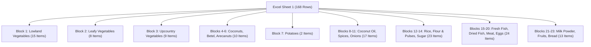

# Sri Lankan Weekly Market Prices (2017–2026) — Layout & Tree Exploration Report

## Executive Summary
This report documents the exhaustive structural exploration of the multi-year Sri Lankan market price dataset spanning **2017 through August 2026**. A total of **698 Excel files** were discovered, cataloged, and inspected. 

Two distinct layout paradigms were discovered across the ~9.5-year history:
1. **Layout Variant A — Unified 23-Block Master Sheet (425 files)**: A single Excel sheet named `"1"` containing a vertical stack of 23 commodity blocks comprising all 122 tracked items.
2. **Layout Variant B — Split Commodity Multi-File Reports (273 files across 39 weekly folders)**: Found exclusively in parts of 2019 and 2020, where each weekly folder contains up to 7 separate Excel files, each containing only 1 specific commodity block (e.g. lowland vegetables, upcountry vegetables, potatoes, spices, onions, rice), while omitting other categories (notably leafy vegetables).

All files across both variants adhere to a uniform 9-column schema (columns A–I) with identical block and product sequences.

---

## 1. Directory Tree Walk & Catalog

### 1.1 Overview & Extensions
- **Root Directory**: `Price folder/`
- **Total Non-Ignored Files**: 698
- **File Extensions**: 100% `.xlsx` (698 files). Zero `.xls` files, lock files (`~$*`), or hidden macOS metadata files (`.DS_Store`) were present in the active dataset.
- **Total Expected Weeks (2017-01-W1 to 2026-08-W4)**: 464 weeks
- **Total Week Folders Found**: 464 week folders (100% temporal folder completeness; zero missing weeks in the folder tree).

### 1.2 File Counts by Year and Month

| Year | Jan | Feb | Mar | Apr | May | Jun | Jul | Aug | Sep | Oct | Nov | Dec | Total Files | Total Weeks | Multi-File Weeks |
|:---:|:---:|:---:|:---:|:---:|:---:|:---:|:---:|:---:|:---:|:---:|:---:|:---:|:---:|:---:|:---:|
| **2017** | 4 | 4 | 4 | 4 | 4 | 4 | 4 | 4 | 4 | 4 | 4 | 4 | **48** | 48 | 0 |
| **2018** | 4 | 4 | 4 | 4 | 4 | 4 | 4 | 4 | 4 | 4 | 4 | 4 | **48** | 48 | 0 |
| **2019** | 28 | 28 | 28 | 28 | 10 | 4 | 4 | 4 | 4 | 4 | 4 | 4 | **150** | 48 | 17 (Jan–May W1) |
| **2020** | 28 | 28 | 28 | 28 | 28 | 10 | 4 | 4 | 4 | 4 | 4 | 4 | **180** | 48 | 22 (Jan–Jun W2) |
| **2021** | 4 | 4 | 4 | 4 | 4 | 4 | 4 | 4 | 4 | 4 | 4 | 4 | **48** | 48 | 0 |
| **2022** | 4 | 4 | 4 | 4 | 4 | 4 | 4 | 4 | 4 | 4 | 4 | 4 | **48** | 48 | 0 |
| **2023** | 4 | 4 | 4 | 4 | 4 | 4 | 4 | 4 | 4 | 4 | 4 | 4 | **48** | 48 | 0 |
| **2024** | 4 | 4 | 4 | 4 | 4 | 4 | 4 | 4 | 4 | 4 | 4 | 4 | **48** | 48 | 0 |
| **2025** | 4 | 4 | 4 | 4 | 4 | 4 | 4 | 4 | 4 | 4 | 4 | 4 | **48** | 48 | 0 |
| **2026** | 4 | 4 | 4 | 4 | 4 | 4 | 4 | 4 | — | — | — | — | **32** | 32 | 0 |
| **Total**| **88**| **88**| **88**| **88**| **74**| **50**| **40**| **40**| **36**| **36**| **36**| **36**| **698** | **464** | **39** |

### 1.3 Folder & File Naming Anomalies
1. **Month Folder Naming**:
   - 3-letter abbreviations: `Jan`, `Feb`, `Mar`, `Apr`, `May`, `Jun`, `Jul`, `Aug`, `Sep`, `Oct`, `Nov`, `Dec`.
   - Full-name variants: `March` (used in 2025 and 2026), `August` (used in 2017), `July` (used in 2017), `June` (used in 2017).
   - Handled systematically via case-insensitive alias dictionary mapping all names to month numbers 1–12.
2. **Week Folder Naming**:
   - Standard lowercase: `w1`, `w2`, `w3`, `w4` (predominantly in 2017–2019, 2023–2026).
   - Capitalized with spaces: `Week 1`, `Week 2`, `Week 3`, `Week 4` (consistently in 2020, 2021, 2022).
   - Handled systematically via digit extraction regex (`r"(\d)"`).
3. **File Naming Within Week Folders**:
   - Single-file weeks: named `file.xlsx` or downloaded with browser increments like `file (12).xlsx`, `file (28).xlsx`.
   - Multi-file split weeks: named `file.xlsx`, `file (1).xlsx` through `file (6).xlsx` (in 2019) or `file(1).xlsx` through `file(7).xlsx` (in 2020).

---

## 2. Longitudinal Layout Comparison Across Years

To ensure parser robustness, the earliest, latest, and intermediate files of every single year were opened and compared:

| Year | Earliest File Examined | Latest File Examined | Sheets | Columns | Layout Variant | Block Count | Row Count |
|:---:|:---|:---|:---:|:---:|:---:|:---:|:---:|
| **2017** | `2017/Jan/w1/file.xlsx` | `2017/Dec/w4/file.xlsx` | `['1']` | A–I (9) | Unified | 23 | 168 |
| **2018** | `2018/Jan/w1/file.xlsx` | `2018/Dec/w4/file.xlsx` | `['1']` | A–I (9) | Unified | 23 | 168 |
| **2019** | `2019/Jan/w1/file.xlsx` | `2019/Dec/w4/file.xlsx` | `['1']` | A–I (9) | Split (Jan–May W1) / Unified (May W2–Dec) | 1 (split) / 23 (unified) | 11–17 / 168 |
| **2020** | `2020/Jan/Week 1/file.xlsx`| `2020/Dec/Week 4/file.xlsx`| `['1']` | A–I (9) | Split (Jan–Jun W2) / Unified (Jun W3–Dec) | 1 (split) / 23 (unified) | 11–17 / 168 |
| **2021** | `2021/Jan/Week 1/file.xlsx`| `2021/Dec/Week 4/file.xlsx`| `['1']` | A–I (9) | Unified | 23 | 168 |
| **2022** | `2022/Jan/Week 1/file.xlsx`| `2022/Dec/Week 4/file.xlsx`| `['1']` | A–I (9) | Unified | 23 | 168 |
| **2023** | `2023/Jan/w1/file.xlsx` | `2023/Dec/w4/file.xlsx` | `['1']` | A–I (9) | Unified | 23 | 168 |
| **2024** | `2024/Jan/w1/file (12).xlsx`| `2024/Dec/w4/file (15).xlsx`| `['1']`| A–I (9) | Unified | 23 | 168 |
| **2025** | `2025/Jan/w1/file (12).xlsx`| `2025/Dec/w4/file (15).xlsx`| `['1']`| A–I (9) | Unified | 23 | 168 |
| **2026** | `2026/Jan/w1/file.xlsx` | `2026/Aug/w4/file (15).xlsx`| `['1']` | A–I (9) | Unified | 23 | 168 |

### Key Findings:
- **Sheet Architecture**: 100% of the 698 files have exactly **one sheet**, named `"1"`.
- **Column Geometry**: Exactly 9 columns (A through I) across all files.
- **Block Order Stability**: The 23 blocks in 2017 match the 2026 block order **100% identically**. Not a single block was reordered, inserted, or removed across 9.5 years.

---

## 3. Structural Anatomy of the Reports

### 3.1 Column Role Definitions

| Column | Internal Meaning | Extraction Treatment | Formatting & Corruption Notes |
|:---:|:---|:---|:---|
| **A** | Product Name & Unit | **Authoritative Product String** | Contains product name and trailing unit. Normalizes non-breaking spaces (`\xa0`) and double spaces. |
| **B** | Reference Period Price | **Ignored** | Prior year same-month price. Header auto-converted by Excel to datetime (e.g. `2025-08-01 00:00:00` for `Aug.2025`). Excluded from master. |
| **C** | Lookback Week 3 (oldest) | **Backfill / Revision Source** | 3 weeks prior to reporting week. Used for lookback backfills and revision audits. |
| **D** | Lookback Week 2 | **Backfill / Revision Source** | 2 weeks prior to reporting week. Used for lookback backfills and revision audits. |
| **E** | Lookback Week 1 (prior) | **Backfill / Revision Source** | 1 week prior to reporting week. Used for lookback backfills and revision audits. |
| **F** | **Authoritative Own Week** | **Primary Price Column** | Header defines file's true reporting week (e.g. `W1.Jan.2017`). Contains official prices for the reporting week. |
| **G** | % Change vs Prior Year | **Ignored** | Heavily corrupted by Excel datetime conversion (e.g. `2034-07-01`, `2001-01-04 23:30`). Discarded completely. |
| **H** | % Change vs Prior Week | **Ignored** | Corrupted by Excel datetime conversion. Discarded completely. |
| **I** | Monthly Average / Notes | **Ignored** | Irrelevant for weekly ML forecasting. Discarded completely. |

### 3.2 Block & Category Structure (23 Blocks, 122 Products)

#### Complete Block Catalog:
1. **Block 1 — Lowland Vegetables (15 products)**: Ash Plantain, Ash Pumpkin, Bandakka, Brinjal, Bitter Guard, Cucumber, Red Pumpkin, Snake Gourd, Kohila Yams, Vetakolu, Green Chillies, Cap Chillies, Limes, Long Beans, Drumstick.
2. **Block 2 — Leafy Vegetables (8 products)**: Gotukola, Kankun, Kathurumurunga, Kohila Leaves, Mukunuwenna, Nivithi, Sarana, Thampala.
3. **Block 3 — Upcountry Vegetables (9 products)**: Leeks, Beans Butter, Beans Green, Beet Root, Cabbagge Seed, Carrot, KnolKhol, Raddish, Tomatoe No1.
4. **Block 4 — Coconuts (4 products)**: Average Coconuts, Large Coconuts, Medium Coconuts, Small Coconuts.
5. **Block 5 — Betel Leaves (3 products)**: Betel Leaves - Average, Betel Leaves - Medium, Betel Leaves - Small.
6. **Block 6 — Arecanuts (3 products)**: Arecanuts - Average, Arecanuts - Medium, Arecanuts - Small.
7. **Block 7 — Potatoes (2 products)**: Local Potatoes, Imported Potatoes.
8. **Block 8 — Coconut Oil (1 product)**: Coconut Oil.
9. **Block 9 — Spices/Condiments (14 products)**: Dried Chillies No1., Corriander, Pepper Powder, Turmeric Powder, Garlic, CumminSeed, Fennel Seed, Mustard, Mathe Seed, Cinnamon, Gorakka, MaldiveFish U, Salt, Tamarind.
10. **Block 10 — Onions (1 product)**: Red Onions Average.
11. **Block 11 — Onions (2 products)**: B.Onions Local, B.Onions Imported.
12. **Block 12 — Rice (14 products)**: Raw Red Average, Raw Red No1., Raw Red No2., Raw Red Imported, Raw White Local, Raw White Imported, Raw White Average, Nadu Red, Nadu White, Nadu White Imported, Samba Average, Samba No1., Samba No2., Ponni Samba Imported.
13. **Block 13 — Flour & Pulses (8 products)**: WheatFlour, Mysore Dhall - Average, Mysore Dhall - No1. Large, Mysore Dhall - No2.Medium, Mysore Dhall - No3.Small, Cowpea Whole Average, Green Gram Average, Kadalai Average.
14. **Block 14 — Sugar (1 product)**: Sugar.
15. **Block 15 — Fresh Fish (8 products)**: Paraw, Mullet, Thalapath, Balaya, Kelewella, Mora, Salaya, Parati.
16. **Block 16 — Fresh Fish (Small Fish & Prawns) (4 products)**: Small Mullet, Hurulla, Linna, Prawns.
17. **Block 17 — Dried Fish (3 products)**: Katta, Spratts, Salaya Average.
18. **Block 18 — Meat (5 products)**: Beef, Mutton, Chicken Fresh, Chicken Broiler, Pork.
19. **Block 19 — Eggs (3 products)**: Egg - Average, Egg - Red, Egg - White.
20. **Block 20 — Tinned Fish (1 product)**: Tinned Fish.
21. **Block 21 — Milk Powder (7 products)**: Maliban, Lakspray, Anchor, Pelwatta, Highland, Lactogen II, Lactogen I.
22. **Block 22 — Fruits (5 products)**: Sour Plantain, Anamalu, Kolikuttu, Papaw, Pineapple.
23. **Block 23 — Bread (1 product)**: Bread.

---

## 4. Special Anomalies & Parser Strategy

### 4.1 Layout Variant B: 2019–2020 Multi-File Split Weeks
In 17 weeks of 2019 (Jan W1–W4, Feb W1–W4, Mar W1–W4, Apr W1–W4, May W1) and 22 weeks of 2020 (Jan W1–W4, Feb W1–W4, Mar W1–W4, Apr W1–W4, May W1–W4, Jun W1–W2), weekly folders contained 7 individual files:
- `file.xlsx` (Lowland Vegetables)
- `file (1).xlsx` (Upcountry Vegetables)
- `file (2).xlsx` (Potatoes)
- `file (3).xlsx` (Spices/Condiments)
- `file (4).xlsx` (Red Onions)
- `file (5).xlsx` (Big Onions)
- `file (6).xlsx` (Rice)

**Impact on Dataset**:
- Lowland vegetables, upcountry vegetables, potatoes, onions, spices, and rice have continuous weekly coverage across these split periods.
- Leafy vegetables, coconuts, fish, meat, eggs, milk powder, fruits, and bread were not included in these split commodity bulletins.
- The parser processes every file in the folder independently and consolidates commodities for that week without collision.

### 4.2 Lookback Backfill Recovery
- In the first unified files published immediately following split eras (e.g. `2019/Jun/w1/file.xlsx` and `2020/Jul/Week 1/file.xlsx`), columns C, D, and E report the preceding 3 weeks' prices.
- **301 missing product-week observations** (including leafy vegetables during transition weeks) were successfully recovered and flagged with `is_backfilled=True` and the source relative path.
- Where prices were never recorded by the reporting agency, they remain empty/null (`NaN`) as mandated.

### 4.3 2020-Jan-Week 3 Duplicate Mismatch
- All 7 files inside folder `2020/Jan/Week 3/` contained header text `W2.Jan.2020` and identical price values to `2020/Jan/Week 2/`.
- **Parser Rule Applied**: Authoritative header text was trusted over the directory path, logged to `mismatches.csv`, and treated as duplicate Week 2 reports.
- **Week 3 Recovery**: True prices for `2020-Jan-W3` were recovered cleanly via backfill from `2020/Jan/Week 4/` lookback column E (`W3.Jan.2020`).

### 4.4 2026 April Header Typo (`Apri`)
- In `2026/Apr/w1` through `w4`, Column F headers were spelled `W1.Apri.2026` through `W4.Apri.2026`.
- Systematic normalization in `MONTH_NORM` maps `apri` to month 4, ensuring zero data loss and automated parsing.

### 4.5 2017 Jan W1–W3 Lookback Headers (`undefined`)
- For `2017/Jan/w1/file.xlsx`, prior weeks did not exist in the database, producing string literal `'undefined'` in headers C, D, and E.
- The parser recognizes `'undefined'` and gracefully ignores lookback slots prior to 2017.
